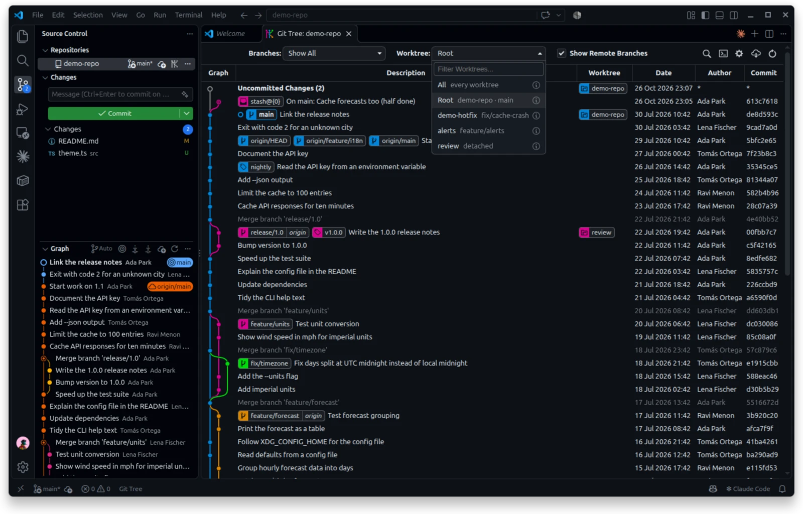
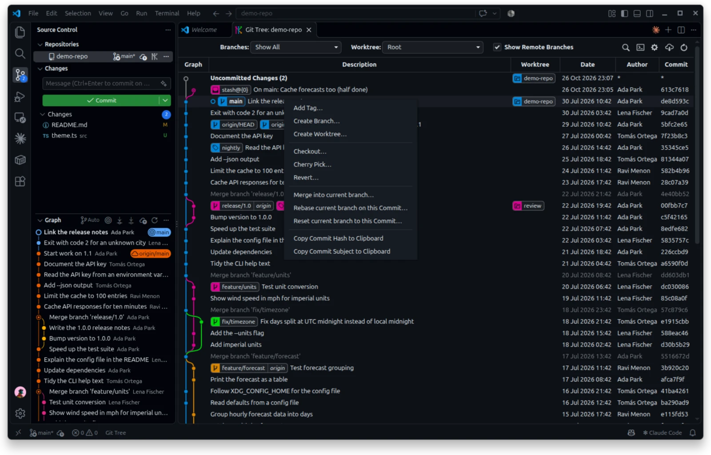

# Git Tree

**A Git graph for Visual Studio Code that understands worktrees.** See every branch, tag, stash and worktree in one graph, see each worktree's uncommitted changes, and run Git actions from a right-click.

[](https://marketplace.visualstudio.com/items?itemName=sidh1999.git-tree-rs)
[](https://marketplace.visualstudio.com/items?itemName=sidh1999.git-tree-rs)
[](https://code.visualstudio.com/)
[](LICENSE)



## Why Git Tree?

Worktrees let you keep several branches checked out at once, each in its own folder. Most Git graphs don't know they exist: a branch checked out in another worktree looks like any other branch, and changes waiting in that worktree are invisible. Git Tree puts worktrees in the graph.

### Features

- 🌳 **Worktrees in the graph.** A Worktree column labels every worktree on the commit it's on, and each worktree's uncommitted changes get their own row.
- 🔎 **A worktree filter.** Show one worktree's history and changes, the main worktree's, or everything at once.
- 🛠️ **Worktree actions.** Create a worktree from a commit or a branch, open it in a new window, remove it, or copy its path. Ctrl+click a worktree to open it.
- 🖥️ **Worktrees on SSH servers.** See the worktrees on your servers in the same graph, add a server from your SSH aliases by browsing its folders, and fetch, pull or push there with your SSH agent.
- 🗂️ **One tab per repository.** Keep several repositories open side by side.
- ⚡ **Fast and light.** A Rust engine reads the repository without starting `git`, and the graph draws only the rows on screen. The view opens up to 3× faster than Git Graph, and drawing 5,000 commits takes 24 ms instead of 400.
- 🎨 **Follows your theme.** Rows, labels, dialogs and the graph's colours are tuned for light and dark themes.
- 🔒 **No telemetry.** Git Tree sends no usage data.

And everything you expect from a Git graph: branches, merges, tags, stashes and remote branches; checkout, merge, rebase, cherry-pick, reset, push and pull from a right-click; commit details with diffs; and comparing any two commits.

## Git Tree compared with Git Graph

Git Tree started from [Git Graph](https://github.com/mhutchie/vscode-git-graph) 1.30.0, and keeps all of its features. Git Tree 0.3 is written in TypeScript and reads the repository by running `git`, as Git Graph does. From 0.4, Git Tree reads it with a Rust engine, and draws only the rows on screen.

### Performance

| | Git Graph 1.30.0 | Git Tree 0.3 (TypeScript) | Git Tree 0.5 (Rust) |
| --- | --- | --- | --- |
| Opening the view, 6,750 commits | 17.5 ms | 19.4 ms | **7.0 ms** (2.5× faster) |
| Opening the view, 6,750 commits, no commit-graph file | 62.9 ms | 63.9 ms, then 19.4 ms once Git Tree writes the file | **45.3 ms**, then **7.0 ms** once Git Tree writes the file |
| Opening the view, a small repository (63 commits) | 10.1 ms | 10.6 ms | **3.2 ms** (3× faster) |
| `git` processes started to open the view | 5 | 6 | **0** |
| A refresh where nothing changed, 6,750 commits | reads everything again (about 17 ms) | reads everything again (about 19 ms) | **1.6 ms** |
| Data sent to the view for 300 commits | about 97 KB | about 97 KB | **40 KB** |
| Data sent to the view when nothing changed | about 97 KB | about 97 KB | **158 bytes** |
| Opening a small commit's details, 6,750 commits | not measured | 14.3 ms | **0.8 ms** |
| A commit's subject / a file at a commit / a remote's URL | not measured | 10.6 / 6.0 / 6.1 ms | **0.6 / 0.6 / 0.3 ms** |
| Reading the settings for the Repository Settings dialog | not measured | 26.4 ms | **0.4 ms** |
| 300 commits in author-date order, 6,750 commits | not measured | 55.2 ms | **4.8 ms** |
| `git status` for uncommitted changes | after `git log` | alongside `git log` | alongside the engine |
| Coming back to a hidden tab | reloads the whole view | refreshes the data only | refreshes the data only |
| Drawing 300 / 2,000 / 5,000 commits | as Git Tree 0.3 | 33 / 162 / about 400 ms | **24 / 22 / 24 ms** |
| Elements on the page, 5,000 commits | as Git Tree 0.3 | about 48,000 | **about 1,600** |
| View memory, 2,000 / 5,000 commits | as Git Tree 0.3 | 199 / 277 MB | **145 / 153 MB** |
| Extension memory after 30 view loads | 31 MB | 33 MB | **28 MB** |
| Worktrees on SSH servers | — | — | **16 ms** a server per refresh, over a shared connection |
| Download size | 346 KB | 336 KB | 8.4 MB, with the engine for every platform |

How these were measured, on Linux x64 with Git 2.55:

- *Opening the view* is the time to read the repository's branches, remotes, stashes, worktrees and refs, and the first 300 commits, through each version's own code. It's the median of 25 runs, with the three versions taking turns. `git status` runs in all three and is left out. The 6,750-commit repository is a copy of a real project.
- A *refresh where nothing changed* is what a file save or a return to the tab costs when the history is the same. Git Graph and Git Tree 0.3 read the repository again, as when opening the view; Git Tree 0.5 checks a fingerprint of everything the commits depend on, and sends the view only its *Uncommitted Changes* rows. The 0.5 figures for refreshes, single reads and the author-date log were measured on a busy machine, so they are rough; the ratios hold.
- *Drawing* is the time from the commits reaching the view to the painted frame, in Chromium, as the median of several runs. Git Graph and Git Tree 0.3 share the same drawing code.
- *View memory* is the memory of the view's page; an empty page takes about 135 MB. *Extension memory* is the extension's own memory, not counting the `git` processes it starts.
- Git Tree 0.4.1 and later ship one package that holds the Rust engine for Windows, macOS and Linux, on x64 and arm64. VS Code loads only the engine for its own platform.

Starting a `git` process costs about 2 ms on Linux, and 40–70 ms on Windows. Git Tree 0.4 and later start none to open the view, so it gains the most on Windows and macOS. Those gains haven't been measured yet.

Git writes the commit-graph file during `git gc`, so many long-lived repositories already have one. Git Tree writes it for repositories that don't.

### Features

| | Git Graph 1.30.0 | Git Tree |
| --- | --- | --- |
| Worktrees shown in the graph | — | ✅ A Worktree column |
| Uncommitted changes | The open repository's only | ✅ Every worktree's, each in its own row |
| Filter the graph by worktree | — | ✅ All, Root or one worktree |
| Create, open and remove worktrees | — | ✅ From a commit or a branch |
| Choose where new worktrees go | — | ✅ Relative, `~`, absolute or `{repo}` paths |
| Open a worktree in a new window | — | ✅ Ctrl/Cmd+click |
| Copy a file's path in another worktree | — | ✅ |
| Worktrees on SSH servers | — | ✅ In the graph, added from Repository Settings |
| Several repositories side by side | One view for all repositories | ✅ One tab per repository |
| Graph colours on light themes | The dark-theme palette | ✅ A darker palette for light themes |
| Install, update and uninstall events | Sent to the author's server | ✅ None sent |

## Getting started

1. Install Git Tree from the Extensions view (search for "Git Tree"), or install a `.vsix` with *Extensions: Install from VSIX...*.
2. Open a folder that is a Git repository.
3. Open the graph in any of these ways:
   - click **Git Tree** in the status bar
   - run **Git Tree: View Git Tree** from the Command Palette
   - click the Git Tree button on a repository in the Source Control view

## Worktrees

### See every worktree

The **Worktree** column shows which worktree has each commit checked out. A branch that's checked out in a worktree keeps its branch label in the description, and the worktree's label sits in the Worktree column on the same row. The column appears when a repository has more than one worktree, and `git-tree.defaultColumnVisibility` can hide it.

Each worktree with uncommitted changes gets its own **Uncommitted Changes** row, drawn from the commit it's on and labelled with the worktree's name. Git Tree watches every worktree, including those outside the repository's folder, so the rows stay up to date.

### Filter by worktree

The **Worktree** dropdown in the top bar filters the graph, the way the Branches dropdown does:

| Choice | Shows |
| --- | --- |
| **All** | Every branch, and every worktree's uncommitted changes |
| **Root** (the default) | The main worktree's history and its uncommitted changes |
| *a worktree's name* | That worktree's history and its uncommitted changes |

Git actions, such as checkout, commit details and opening files, run in the worktree you pick. Branches you pick in the Branches dropdown are shown as well. The dropdown appears when a repository has more than one worktree.

### Create, open and remove worktrees

Right-click to work with worktrees:

- **A commit:** *Create Worktree...*. Enter a new branch name to create that branch at the commit and check it out in the worktree, or leave it blank for a detached HEAD.
- **A branch that isn't checked out:** *Create Worktree...* checks the branch out in a new worktree.
- **A branch checked out in another worktree:** *Open Worktree in New Window*. Git won't check out or delete such a branch, so those actions are hidden.
- **A worktree label:** show the worktree, open it in a new window or this one, remove it, or copy its path.

**Ctrl+click** (**Cmd+click** on macOS) or double-click a worktree label to open that worktree in a new VS Code window.



### Where new worktrees go

New worktrees go in the `.worktrees` folder of the main worktree by default, for example `.worktrees/feature-login`. Type another folder in the dialog, or change the default with `git-tree.worktree.defaultLocation`. Both accept:

| Form | Example | Means |
| --- | --- | --- |
| A relative path | `.worktrees`, `../{repo}-worktrees` | Relative to the main worktree |
| A home path | `~/worktrees/{repo}` | Inside your home folder |
| An absolute path | `/srv/worktrees` | Exactly that folder |

`{repo}` becomes the repository's folder name, which keeps each repository's worktrees apart. When the folder is inside the repository, Git Tree adds it to `.git/info/exclude`, so the worktrees don't show up as untracked files.

### File paths in worktrees

A file has a different absolute path in each worktree. In Commit Details, Open File and Copy Absolute File Path use the worktree you're viewing. To copy the path in another worktree, right-click the file and choose *Copy Absolute File Path in Another Worktree...*.

### Worktrees on SSH servers

Git Tree can show the worktrees on your SSH servers in the same graph as your local ones. Each server worktree gets a label in the Worktree column, such as `build-box:main`, its own *Uncommitted Changes* row, and a place in the Worktree filter. The server's branches are drawn like remote branches, under the host's name. The server needs only `git`; Git Tree installs nothing there.

Add a host in **Repository Settings → Remote Hosts**:

1. Pick an SSH alias. Git Tree lists the aliases in `~/.ssh/config` and the files it includes, or you can type one.
2. Choose **Add existing** to use a repository that's already on the server, or **Create new** to make one there. A new repository is either cloned on the server from one of this repository's remotes, or pushed from this machine.
3. Pick the folder by browsing the server. Repositories and worktrees are marked.
4. Choose whether to show the server's worktrees, and whether to forward your SSH agent. Git Tree checks the connection and that the server has the same project before it saves the host.

Each host's row shows its state and when it was last read. From the row you can check, edit, hide or remove the host, and fetch, pull or push on the server. *Hide* takes a host's worktrees and branches out of the graph, the way hiding a remote does, and Git Tree stops reading that host until you show it again.

*Git Tree: Add Remote Host...* in the Command Palette adds an existing repository too, with its path typed instead of browsed. Or write `.worktrees/git-tree.yaml` in the main worktree yourself:

```yaml
version: 1
hosts:
  build-box:                          # the name shown in the graph
    ssh: build-box                    # a Host alias from ~/.ssh/config
    path: /home/ubuntu/projects/app   # the repository's main worktree on the server
    worktrees: true                   # include its linked worktrees (default: true)
    forwardAgent: true                # forward your SSH agent to Git on the server (default: false)
```

User names, ports, keys and jump hosts stay in `~/.ssh/config`. The file lives in `.worktrees/`, which Git Tree excludes from Git, so it's never committed.

**Forwarding your SSH agent** lets Git on the server reach GitHub, or any other server, with the keys on your machine. Git Tree forwards it only for the commands that need it: cloning a new repository, and fetch, pull and push on the server. Each of those gets its own SSH connection, which closes when the command ends. While it's open, anyone with root on the server can use your agent, so turn it on only for servers you trust.

On each refresh, Git Tree reads every host over one SSH call: its worktrees, their branches and how many uncommitted changes each has. It reuses one SSH connection per host (OpenSSH's connection sharing), so a refresh after the first costs about one network round trip; Windows' OpenSSH can't share connections, so there each refresh connects again. When a server's branches moved, Git Tree fetches them into hidden refs under `refs/git-tree/hosts/<name>/`, which don't show up in `git branch -a`. Git Tree asks before the first fetch from each host. A slow or unreachable host never holds up the local graph: it shows *unreachable*, with the time of its last good refresh, and never looks clean.

Right-click a server worktree's label to open it in VS Code with [Remote-SSH](https://marketplace.visualstudio.com/items?itemName=ms-vscode-remote.remote-ssh), open a terminal there, fetch, pull or push on the server, copy its path or remove it. Right-click a commit to create a worktree on a server. Removing a host, in Repository Settings or with *Git Tree: Remove Remote Host*, also deletes its hidden refs.

Coding agents can keep the host list up to date. Click **Copy** next to *Using a coding agent?* in the Remote Hosts section, and paste the instruction into your agent's instructions, for example `CLAUDE.md` or `AGENTS.md`. The same text is in [the agent instruction](docs/remote-hosts-for-agents.md).

## Everyday use

### Commit details and comparisons

Click a commit to see its details and changed files. Click a file to see its diff, or right-click it to open the file, view it at that commit, or copy its path. Ctrl+click (Cmd+click) a second commit to compare the two.

### Tabs

Each Git Tree tab shows one repository, and its title names the repository and the worktree. Opening a repository switches to the tab that already shows it, or opens a new one. Run *Git Tree: View Git Tree in New Tab...*, or click **+** in a Git Tree tab's title bar, to open another tab.

### More

- **Branches dropdown:** show all branches, pick some, or use your own glob patterns (`git-tree.customBranchGlobPatterns`).
- **Find** (Ctrl/Cmd+F): find commits by message, date, author, hash, branch or tag.
- **Code review:** keep track of the files you've reviewed in a commit or a comparison. Reviews last across sessions.
- **Repository settings:** manage remotes, link issue numbers in commit messages to your tracker, and set up pull request creation for GitHub, GitLab, Bitbucket or your own provider.
- **Columns:** resize them, and show or hide Date, Author, Commit and Worktree.

### Keyboard shortcuts

| Shortcut | Action |
| --- | --- |
| Ctrl/Cmd+F | Find |
| Ctrl/Cmd+H | Scroll to the HEAD commit |
| Ctrl/Cmd+R | Refresh |
| Ctrl/Cmd+S, Ctrl/Cmd+Shift+S | Scroll to the next or previous stash |
| Up, Down | With Commit Details open: the commit above or below |
| Ctrl/Cmd+Up, Ctrl/Cmd+Down | With Commit Details open: the child or parent commit on the same branch (add Shift to follow the other branch) |
| Enter | Submit a dialog |
| Escape | Close a dialog, a menu or Commit Details |

## Settings

All settings start with `git-tree.`. Search for "Git Tree" in the Settings editor to see each one. Settings that are new in Git Tree:

| Setting | Default | What it does |
| --- | --- | --- |
| `git-tree.worktree.defaultLocation` | `.worktrees` | The folder new worktrees go in. See [Where new worktrees go](#where-new-worktrees-go). |
| `git-tree.repository.writeCommitGraph` | on | Writes Git's [commit-graph](https://git-scm.com/docs/git-commit-graph) file in the background when a repository has none. |
| `git-tree.remoteHosts.sshPath` | `ssh` | The `ssh` executable for [remote hosts](#worktrees-on-ssh-servers), if it isn't on the PATH. |
| `git-tree.remoteHosts.refreshInterval` | 0 (off) | Refresh remote hosts every so many seconds, as well as when the view opens, regains focus or is refreshed. |

If `git-tree.graph.colours` isn't set, the graph uses a darker palette on light themes. A repository's shared Git Tree configuration lives in `.vscode/vscode-git-tree.json`.

## Commands

| Command | What it does |
| --- | --- |
| Git Tree: View Git Tree | Opens the graph |
| Git Tree: View Git Tree in New Tab... | Opens a repository in another tab |
| Git Tree: Fetch from Remote(s) | Opens the graph and fetches |
| Git Tree: Add Git Repository... | Adds a repository that wasn't found automatically |
| Git Tree: Remove Git Repository... | Removes a repository from Git Tree |
| Git Tree: Add Remote Host... | Adds an SSH server's worktrees to the graph, after checking the connection |
| Git Tree: Remove Remote Host | Removes a server and its hidden refs |
| Git Tree: Resume a specific Code Review in Workspace... | Reopens a code review in progress |
| Git Tree: End a specific Code Review in Workspace... | Ends one code review |
| Git Tree: End All Code Reviews in Workspace | Ends every code review |
| Git Tree: Clear Avatar Cache | Clears the cached author avatars |
| Git Tree: Get Version Information | Shows the versions of Git Tree, Git and VS Code |

## Requirements

- Visual Studio Code 1.82 or later
- Git 2.31 or later. With an older Git, Git Tree shows a message that asks you to upgrade Git, or to point `git.path` at a newer Git.
- Windows 10 or later, macOS 15 or later, or Linux with glibc 2.28 or later or with musl, on x64 or arm64

## Known limitations

- Git Tree draws every loaded commit. Very long histories take longer to draw; *Load More Commits* loads them in steps.
- Each worktree adds one `git status` to every refresh, so a repository with many worktrees refreshes more slowly.

## Support

- Report a bug or ask for a feature in [GitHub Issues](https://github.com/sidhanthapoddar99/git-tree/issues).
- The [changelog](CHANGELOG.md) lists what changed in each version.
- To work on Git Tree itself, see the [developer guide](CONTRIBUTING.md).

## License

Git Tree is under the MIT License in [LICENSE](LICENSE). Some code and icons come from other projects, under the licenses in the [licenses](licenses) folder.

Some of the icons are from the following sources:
- [GitHub Octicons](https://octicons.github.com/) ([License](https://github.com/primer/octicons/blob/master/LICENSE))
- [Icons8](https://icons8.com/icon/pack/free-icons/ios11) ([License](https://icons8.com/license))
